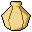

<!-- PROJECT LOGO -->
 

  
  

<h3 align="center">otter</h3>

  <strong>A fast INI library, fully utilizing the CPU for fast parsing and writing</strong>

  <a href="#features">Features</a> -
  <a href="#usage">Usage</a> -
  <a href="#building">License</a> -
  <a href="#deviations-from-windows">Deviations</a> -
  <a href="#license">License</a>

---

## Deviations from Windows

## License

This repository uses two licenses: the source code is open source, and the artwork is not.

* **Source Code:** All software and source code files are licensed under the **[MIT License](./LICENSE)**. You are free to use, modify, and distribute the code commercially or non-commercially.
* **Icons & Assets:** Everything in the **[`/icons`](./icons/)** directory is excluded from the MIT License. All rights reserved: do not copy, redistribute, modify, or use these files (including for AI training) without written permission. See the **[Icon License](./icons/LICENSE-ART.md)**. Forks are welcome, but the icons stay under their own terms.

  
Made with ❤️

